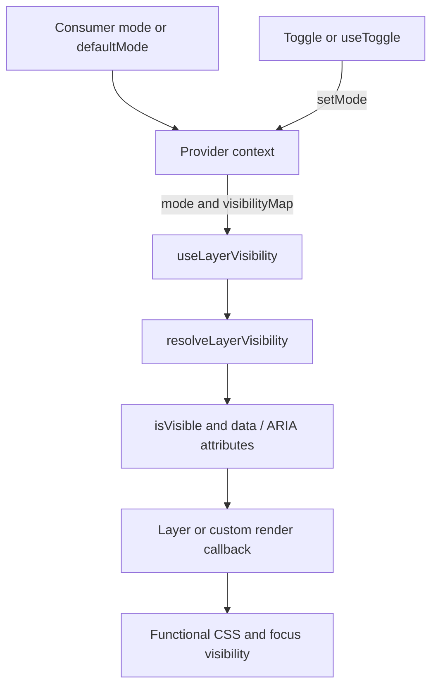

# Documentation maintenance

## Audiences and reading paths

| Reader outcome | Path |
| --- | --- |
| Adopt the content format | [README](../README.md) → [format specification](../FORMAT-SPEC.md) |
| Integrate and customize React | [quick start](../README.md#quick-start) → [API reference](./API.md) → [demo](../examples/demo/README.md) |
| Integrate Markdoc | [Markdoc guide](../markdoc/README.md) → React API/provider setup |
| Contribute and operate releases | [contribution checks](../CONTRIBUTING.md#workflow) → [publishing runbook](../PUBLISHING.md) |
| Maintain this documentation | This source map → [visibility ADR](./adr/ADR-0001-layer-visibility.md) → validation below |

## Source map and ownership

Page ownership is by responsibility, not a personal name. The contributor
changing a source owns its companion documentation update; maintainers review it.

| Authoritative source | Documentation owner | Update trigger |
| --- | --- | --- |
| [public exports](../src/index.ts), [types](../src/core/types.ts) | [API reference](./API.md), README quick start | Export, signature, prop, option or default changes |
| [constants](../src/core/constants.ts), [visibility](../src/core/visibility.ts), [provider](../src/primitives/Provider.tsx), [layer tests](../src/__tests__/layers.test.tsx) | API reference, [specification](../FORMAT-SPEC.md), visibility ADR | Mode, mapping, state or accessibility behavior changes |
| [stylesheet](../src/styles.css) | API styling and README styling | Variable, hiding, focus or motion behavior changes |
| [package metadata](../package.json), [build](../tsup.config.ts) | README install/API setup, [contributor guide](../CONTRIBUTING.md) | Exports, packaging, peer requirements or package manager changes |
| [CI](../.github/workflows/ci.yml) | Contributor guide and validation instructions | Check commands or environment changes |
| [release workflow](../.github/workflows/publish.yml) | [publishing guide](../PUBLISHING.md) | Release/authentication/registry workflow changes |
| [demo source](../examples/demo/src/App.tsx), [Pages workflow](../.github/workflows/pages.yml) | [demo guide](../examples/demo/README.md) | Demo behavior, setup or deployment changes |
| [Markdoc guide](../markdoc/README.md) | Integration examples (maintainer review) | Renderer or integration changes; these are recipes, not a shipped adapter package |

Source code/tests establish current package behavior; the format specification
owns authoring semantics. A disagreement must be reconciled explicitly, with an
ADR for a non-trivial behavior or architecture choice. Do not silently infer a
new feature from documentation wording. Release notes are generated by
release-please as explained in the publishing guide.

## State and visibility architecture

Sources: [Provider](../src/primitives/Provider.tsx),
[toggle hook](../src/core/hooks/useToggle.ts),
[layer hook](../src/core/hooks/useLayerVisibility.ts),
[resolver](../src/core/visibility.ts), [Layer](../src/primitives/Layer.tsx),
[CSS](../src/styles.css). `ProgressiveDepthProvider` composes Provider, Root and
the optional styled toggle. Persistence is opt-in and separate from the provider.

Diagram inventory: this diagram owns the state/visibility flow. Update it when
context, mapping or rendering ownership changes. It is a conceptual dependency
flow, not a deployment diagram.

## Maintaining with docs-architect

Use the installed docs-architect skill through its reactive runtime. Start from
README, this page, API reference, format spec, integration/runbooks, `src`,
`package.json`, tests and `.github/workflows`; name the audience and observable
reader outcomes for each run. Follow discovery, source extraction, design,
authoring, diagrams and validation before requesting publication review.

Authored Markdown in this repository is the maintained baseline. The runtime
owns `.docs/docs-architect/` projections; never hand-edit generated projections.
Local event databases/logs under `.reactive/` and per-run projections under
`.docs/docs-architect/jobs/` are ignored because they contain execution records.
Keep source facts as source-linked strings where required by the projection
renderer. Record non-trivial choices in `docs/adr/ADR-XXXX-*.md` with status,
context, decision and consequences. Preserve accepted decisions; record changed
choices in a superseding ADR and update the old status. Do not mark a run
published without its actual review decision.

## Validation

For a documentation change:

1. Check local file links and heading anchors, including any renamed headings;
   verify changed external destinations when used as evidence.
2. Typecheck complete TSX examples against the built package. Illustrative
   integration fragments (for example Markdoc recipes) need their host project's
   dependencies/configuration; distinguish these from complete runnable examples.
3. Run the [contributor checks](../CONTRIBUTING.md#workflow) when validating a
   baseline that describes package behavior. Compare docs to tests and sources,
   rather than treating passing code tests as proof that prose is correct.
4. Review diagram syntax and source mappings. Review contradictions and record
   the final decision before publication. A local validation result is not a
   publication approval.

A new documentation platform or CI dependency is not required for this small
Markdown baseline. Repeat source/link/example validation when the corresponding
source or page changes, and include the evidence in the review handoff.
